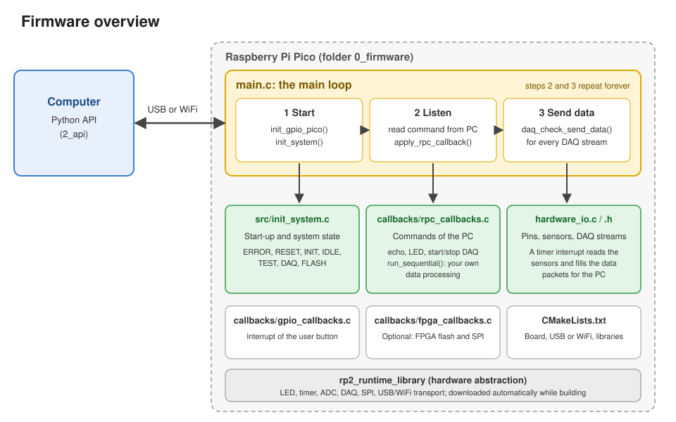

# Firmware for RP2xxx devices
This folder contains the firmware template for the Raspberry Pi RP2xxx MCUs . It runs a small main loop, answers the commands of the [Python API](../2_api/README.md) and sends measurement data (DAQ) to the computer via USB or WiFi.

## Structure

| File                           | What it does                                                                                       |
|--------------------------------|----------------------------------------------------------------------------------------------------|
| `main.c`                       | Starts the system and runs the main loop: receive commands, send data                              |
| `src/init_system.c`            | Initialisation and the system state (`ERROR`, `RESET`, `INIT`, `IDLE`, `TEST`, `DAQ`, `FLASH`)      |
| `callbacks/rpc_callbacks.c`    | The commands of the computer (echo, LED, DAQ start/stop, `APPLY_DATA`, `PROCESS_DATA`, `GET_CHARAC_PROCESSING`)                            |
| `src/user_logic.c` / `.h`      | Your own data processing (`run_sequential()`)                                                       |
| `hardware_io.c` / `.h`         | Pins, sensors, DAQ streams and the timer interrupt, which reads the sensors                        |
| `callbacks/gpio_callbacks.c`   | Interrupt of the user button                                                                       |
| `callbacks/fpga_callbacks.c`   | Optional: FPGA flashing and SPI (only built if the FPGA libraries are enabled)                     |
| `transport_wifi_config.h`      | WiFi name, password and port (only needed for the WiFi transport)                                  |
| `CMakeLists.txt`               | Board, transport (USB or WiFi) and used libraries                                                  |

The hardware drivers (LED, timer, ADC, DAQ, SPI, transport, ...) come from the [rp2_runtime_library](https://github.com/AErbsloeh/rp2_runtime_library). It is downloaded automatically while building, so nothing has to be installed by hand.

## Installation with VS Code
1. Install [Visual Studio Code](https://code.visualstudio.com/).
2. Open the extensions tab, search for **Raspberry Pi Pico** and install the extension of Raspberry Pi. It installs the Pico SDK, the compiler and the tools automatically, no manual setup is needed.
3. Open this folder (`0_firmware`) in VS Code with *File > Open Folder*. Please open exactly this folder and not the whole repository. VS Code suggests some more extensions (C/C++, Serial Monitor, Cortex-Debug), please install them.
4. Click the Raspberry Pi Pico icon in the left sidebar and choose **Import Project**. Select the folder `0_firmware`. Keep the suggested SDK version (see `CMakeLists.txt`) and confirm. The first import takes a few minutes, because the SDK and the toolchain are downloaded.
5. Select your board in the `CMakeLists.txt` with the line `set(PICO_BOARD pico2 ...)`: `pico`, `pico_w`, `pico2` or `pico2_w`.

## Build and Flash
1. Click **Compile** in the blue status bar at the bottom of VS Code (or the entry *Compile Project* in the Pico sidebar). The result is the file `build/main.uf2`.
2. Connect the Pico to the computer via USB. If it is not in the boot mode yet, unplug it, hold the **BOOTSEL** button and plug it in again. The Pico shows up as a USB drive.
3. Click **Run** in the status bar. The firmware is flashed and the Pico restarts. Alternatively, copy `build/main.uf2` to the USB drive of the Pico.

After this, the Pico appears as a serial port and the Python API can connect to it (see `2_api`).

## USB, WiFi or Bluetooth
The data transfer is selected with `TRANSPORT_BACKEND` in the `CMakeLists.txt`:
- `usb` (default): the Pico is connected by cable.
- `wifi`: needs a board with WiFi (`pico_w`, `pico2_w`). Enter the name and the password of your network in `transport_wifi_config.h`. The Python API connects to the Pico with its IP address and the port `4242`.
- `bt`: Bluetooth Classic (serial port profile), needs a board with CYW43 (`pico_w`, `pico2_w`) or a Raspberry Pi Radio Module 2 (see the library README). Pair the computer with the device (name `PICO RP2 ...`, PIN `0000`) and use the virtual serial port of the connection like the USB port, e.g. `DeviceAPI(com_name="/dev/cu.PICORP2")`. WiFi and Bluetooth cannot be used in the same firmware.

After changing it, delete the folder `build` (or run *CMake: Delete Cache and Reconfigure*) and compile again.

## Two cores
The firmware uses both cores of the RP2xxx:
- **Core 0** runs the main loop: communication with the computer (USB or WiFi), the commands, the timer interrupt which reads the sensors and the sending of the data packets. Only core 0 may use the transport (`transport_write`).
- **Core 1** runs the data processing (`hal/daq/processing.c` of the runtime library, with your function from `src/user_logic.c`). `init_system()` initialises it with `processing_init(&processing_config)` and starts it with `processing_start()`; if one of them returns false, the system state is `STATE_ERROR`. It waits for data blocks and calls `run_sequential()` for each of them.

Two kinds of data go through `run_sequential()`, each with its own queue to core 1 (`processing_submit()` hands a block to core 1):
- **Sensor data (normal operation)**: The timer interrupt `irq_tmr_daq0` hands every sample to `processing_push_sample()`. The samples are collected until a block (`num_samples`) is complete.
- **Data from the computer (test operation)**: The commands `APPLY_DATA` (fills the input block) and `PROCESS_DATA` (hands the block to core 1) return at once without a response.

Core 1 writes the results of both into the DAQ stream `daq_config1` (`daq_out` in `processing_config`), which core 0 sends in the main loop with `daq_check_send_data()` like `daq_config0` (on the host it appears as `data1`). `daq_config0` sends the raw sensor data. The stream `daq_config1` has the layout of the output block and contains its bytes unchanged. There is no own send function and no code for the processing in the main loop.

Core 1 only takes the next block if the buffer of the stream is not full, so the result always fits and no result is lost (a stream with several samples collects the results of several blocks and is sent when it is full). While core 0 has not sent the full FIFO (or the host is slow), the blocks wait in the queue; if it is full (`queue_depth` blocks), the new block is dropped and counted (`processing_get_num_dropped()`). The DAQ module of the library locks the FIFO with a spinlock while core 1 writes into it and while core 0 empties it, so both cores can use a stream. Please use each peripheral (ADC, SPI, I2C) from one core only.

The settings of the processing are in `processing_config` in `hardware_io.c`. Besides the layout, they contain the queue depth, the DAQ stream for the results (`daq_out`) and the function which core 1 calls for each block (`func`). It describes the data block which goes into the processing (`in`) and the block which comes out (`out`) with `num_channels`, `num_samples` (per channel) and `element_size` (bytes per value), in the same order as the DAQ streams (samples one after another, channels interleaved). The size of one block and so the size of the queue elements follow from these numbers, and `run_sequential()` gets the settings to find channels and samples in the data. The template has 2 input channels (the array `data_raw0` of the timer interrupt goes into the processing as it is, 2 bytes per value) and 1 output channel; `run_sequential()` selects the data, the template copies channel 0 (echo). The input block comes from the computer with two commands: `APPLY_DATA` writes the bytes of its frame into a buffer of the size of the input block. The first data byte of the frame is a counter (index of the frame), the other bytes are the content of the block at this index, so a lost frame only leaves its own bytes at 0 and the counter allows up to 256 frames per block (the frame size is the one of all commands, set by `rx_buffer` in `hardware_io.c`: `length` = 1 command byte + data bytes, `position` = `length - 1`; the Python API has to use the same number in `_num_bytes_data`), so a block needs several frames (`length - 2` bytes of the block per frame). `PROCESS_DATA` hands the buffer to core 1 and sets it to 0 again; bytes which were not applied are 0 and bytes behind the end of the block are dropped. `GET_CHARAC_PROCESSING` returns the layout of the input and output block (channels, samples, bytes per value), so the Python API can pack the data. All of them return at once without a response, except the layout.

The layout of the output block (`out` in `processing_config`) and the DAQ stream `daq_config1` have to match, so please change `num_channels`, `num_samples` and `element_size` in both places in `hardware_io.c` (`num_samples` of the stream has to be a multiple of the `num_samples` of the block, so the stream collects several blocks, or the stream sends single samples with `DAQ_MODE_SAMPLE` and the block has one sample; the stream only needs `num_channels` and `element_size` of the block). `data_type` of `daq_config1` sets the type of the output stream (`DAQ_TYPE_*` of the library): `SAMPLE` (one result per sample, e.g. filter or echo), `CONT_WINDOW` (continuous windows with a fixed step, one after another or overlapping), `EVENT_WINDOW` (windows around an event), `FEATURE` (features of a window), `EVENT` (irregular events) or `CLASS` (classification result). The type is part of the answer of `GET_CHARAC_DAQ` and is available in Python as `DataAcquisitionConfig.data_type` (`DaqDataType`). The data blocks have the byte order of the DAQ streams (little endian). The interrupt `irq_tmr_daq0` hands the whole array `data_raw0` to `processing_push_sample()`, please adapt it if you change the input layout. The Python API reads 24 bit values (3 bytes per value) of a DAQ stream as signed or unsigned integers.

## Adapt it to your project
- **Own sensors and drivers**: add the files to the folder `src` and to the list of source files in the `CMakeLists.txt`. Libraries of the runtime library are activated by removing the `#` in front of their name in the list `target_link_libraries`.
- **DAQ streams**: sensor reading and packet configuration are in `hardware_io.c` (`daq_config0` for the raw sensor data, `daq_config1` for the results of `run_sequential`, and the timer interrupt `irq_tmr_daq0`).
- **Own data processing**: write your function into `run_sequential()` in `src/user_logic.c` and adapt `processing_config` in `hardware_io.c`. The Python API sends data to it with `process_data()`; the results come with the DAQ stream `data1`.
- **New commands**: add them to the list `usb_cmd_t` in `callbacks/rpc_callbacks.h` and to `apply_rpc_callback()`. The list in `2_api/api/definitions.py` has to use the same order.
