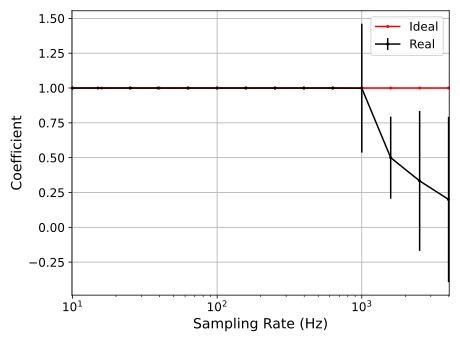
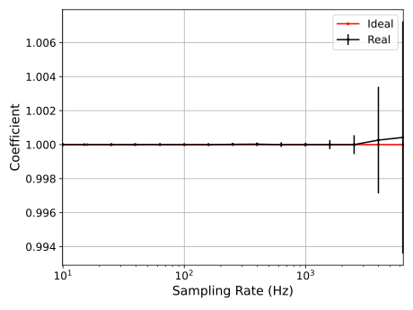

# Python API and Runtime for Custom DAQ Hardware
Host side of the RP2xxx runtime template. It talks to the firmware in `0_firmware`, acquires data from the device, publishes it as Lab Streaming Layer (LSL) streams, plots and records it. Optional building blocks cover FPGA boards and a digital twin of the measurement chain.

## Features
| Area                   | What you get                                                                                                                                              | Where                                                               |
|------------------------|-----------------------------------------------------------------------------------------------------------------------------------------------------------|---------------------------------------------------------------------|
| Device control         | USB or WiFi (TCP) connection, reset, state and pin readout, LED control, echo test                                                                        | `DeviceAPI`                                                         |
| Data acquisition       | Several DAQ streams of the firmware at once, sample or batch transfer, CRC check, package-loss detection, re-synchronisation, sampling rates below 10 kHz | `DeviceAPI.start_daq`                                               |
| Live streaming         | Each DAQ stream is published as LSL stream (`data0`, `data1`, ...), optionally a processed stream `filt`                                                  | `DeviceAPI.start_daq`                                               |
| C reader (optional)    | Reading, decoding and pushing the DAQ packets into LSL in a C thread (`api/c_reader`), for high data rates                                                      | `DeviceAPI.start_daq(use_c_reader=True)`                            |
| Live plot              | PyQtGraph plot with freely arranged channels, configured in code or by a JSON file                                                                        | `setup_live_plotter`, `add_plot_channel`, `save/load_plotconfigs_*` |
| Recording and analysis | HDF5 recording incl. CPU/RAM utilisation of the host, reading and evaluating the files                                                                    | `DataAPI`, `examples/plot_data.py`                                  |
| FPGA (optional)        | Design templates, flashing of bitstreams, power/program/reset control, LED and data exchange over an SPI middleware                                       | `FlashFPGA`, `elasticai.fpga_testing`                               |
| Digital twin           | Software model of the measurement chain: processes an LSL stream, records it, plots input against output                                                  | `twin`                                                              |

## Installation Guide
For using this framework, the following software tools are necessary / recommended.
- `uv` package manager ([Link](https://docs.astral.sh/uv/), [Using](https://www.saaspegasus.com/guides/uv-deep-dive/))
- git ([Link](https://git-scm.com/downloads))
- PyCharm Community Version ([Link](https://www.jetbrains.com/de-de/pycharm/download/#section=windows))

We recommended to install all python packages for using this API with a virtual environment (venv). Therefore, we also recommend to `uv` package manager. `uv` is not a standard package installed on your OS. For this, you have to install it in your Terminal (Powershell on Windows) with the following line.
```
powershell -c "irm https://astral.sh/uv/install.ps1 | iex"
```
Afterwards you can create the venv and installing all packages using this line.
```
uv sync (--refresh --upgrade)
```
In the last step, you activate the Python Environment of your venv. Python 3.13 or 3.14 is needed.

If you create a new repo and you want to use the functionalities of this Python tool. Then please initialise the project.toml using `uv` and write the following code into the terminal.
```
uv add "git+https://github.com/AErbsloeh/rp2_runtime_example.git"
```
The packages `api` and `twin` are installed. The tools for the FPGA design templates (`elasticai-hw-measurements`) are in the dependency group `fpga`, which is not part of the default groups, because it installs PyTorch. Install it with `uv sync --group fpga` if you need the FPGA workflow, in your own project add the package `elasticai-hw-measurements` yourself.

## Quick Start
Flash the firmware of `0_firmware` on the RP2xxx and run:
```python
from api import DeviceAPI

dut = DeviceAPI()                              # USB, the serial port is found by the VID of the RP2xxx
dut.set_liveplotter_config_manually()          # example plot layout, see below for your own layout
dut.start_daq(sampling_rate=1000.0, window_sec=10.0)   # blocks while the plot window is open
dut.stop_daq()
```
Further scripts are listed in [Examples](#examples).

## Device Control
```python
dut = DeviceAPI()                                                       # USB (com_name="AUTOCOM" searches the port)
dut = DeviceAPI(transport="wifi", host="172.20.10.5", port=4242)       # WiFi (TCP), needs the WiFi transport in the firmware

dut.echo("hello")        # communication test with a string
dut.echo_value(-1234)    # loopback of one signed 24 bit integer (returns the value from the device)
dut.process_data(-1234)  # sends one signed 24 bit integer to `run_sequential` of the firmware, returns the result (None without response)
dut.get_state()          # system state and active pins
dut.toggle_led()         # also enable_led(), disable_led()
dut.do_reset()           # restart of the firmware
```
Names of pins and states of your own firmware are added with `extend_pins_list` and `extend_states_list`. The commands are defined in `api/definitions.py` and correspond to the callbacks of the firmware (`0_firmware/callbacks`).

## Data Acquisition
`start_daq(sampling_rate, window_sec, do_plot, do_record, do_process, folder_name, stream_names, use_c_reader)` reads the DAQ streams of the firmware and starts the acquisition.
- **Several streams**: The firmware can provide multiple DAQ streams with own packet ids, channels and transfer modes (sample or batch). Each one is published as own LSL stream: `data0`, `data1`, ... or the names in `stream_names`.
- **Robust transfer**: Packets of different streams may arrive in any order. The API checks tail byte and CRC, detects lost packets and re-synchronises after corrupt data. `stop_daq()` reports the number of losses.
- **Processing**: With `do_process=True` the first stream is processed and published as LSL stream `filt`. The function is an example in `mcu_api.py` and has to be adapted to your project.
- **C reader**: With `use_c_reader=True` the C thread of `api/c_reader` reads the interface, decodes the packets and pushes them into the LSL streams (format `int32`) without the Python interpreter. The library is built with the system C compiler on first use (POSIX only, see `api/c_reader/README.md`); the processing, recording and plot work as before. `stop_daq()` reports losses and skipped bytes of the C reader.
- **Waiting**: `wait_daq(seconds)` waits and raises errors of the threads (e.g. missing consumers or lost device). Without plot, the call of `start_daq` returns directly.

## Live Plot
The plot shows LSL channels in a grid of plots, the time axis is relative to now.
```python
dut.setup_live_plotter(plot_titles=[["Raw", "Filtered"]])               # grid of plots [row][column]
dut.add_plot_channel("data0", "CH0 Raw", "LSB", "r", (0, 0), 0)         # stream, name, unit, colour, position, channel
dut.add_plot_channel("filt", "CH0 Filtered", "LSB", "b", (0, 1), 0)
dut.save_plotconfigs_to_json("config.json")                             # and load_plotconfigs_from_json(...)
```
Names, units and positions of the plot channels are also written into the metadata of the LSL streams and of the recording.
Mouse control of the plot window (all plots share the time axis):
- **Left mouse button, drag**: select a time range, all plots zoom into it. The plots are frozen, so the range does not move away.
- **Mouse wheel / middle mouse button**: zoom or move the time axis. The y-axis always fits the visible data.
- **Right click**: freeze all plots or continue with the live data (the data are still received and recorded while frozen).
- **Double click**: back to the whole time window with live data.

The context menu of PyQtGraph is disabled for this.

## Recording and Analysis
With `do_record=True` all streams (and the utilisation `util` of the host) are written into one HDF5 file in the folder `runs` of the project (`folder_name`). The `DataAPI` reads the files:
```python
from pathlib import Path
from api import DataAPI, get_path_to_project

data_api = DataAPI(Path(get_path_to_project()) / "runs")
data_api.select_file(-1)                  # newest file
data = data_api.get_data("data0")         # StreamRecording: time, data, sampling_rate, label, units, ...
```
`examples/plot_data.py` shows plots of the transient, the sampling time, its drift and the host utilisation.

## FPGA Support (optional)
The runtime can program and control an FPGA connected to the MCU: SPI flash of the FPGA, power, program and reset lines and an SPI middleware for data exchange. The support has to be enabled on both sides:
1. **Firmware**: Enable `peri_fpga_flash` and/or `peri_fpga_spi` in `LINK_LIBS` of `0_firmware/CMakeLists.txt`. CMake then sets `ADD_FPGA_SUPPORT` and adds `callbacks/fpga_callbacks.c`.
2. **Python**: Declare the FPGA with `DeviceAPI.has_fpga = True` before creating the interface. Without it `FlashFPGA()` raises a `RuntimeError` and the FPGA tests are skipped.

### Design Templates
Templates for FPGA designs (top module, SPI middleware, constraints, build scripts) are generated with `elasticai.fpga_testing` from the package `elasticai-hw-measurements`:
```python
from elasticai.fpga_testing import copy_design, copy_oss_cad_scripts, init_project_folder

init_project_folder()                     # once: folder structure of the FPGA workflow in your project
copy_oss_cad_scripts()                    # build scripts for the OSS CAD suite (e.g. Lattice iCE40UP5K, CologneChip GateMate A1)
copy_design.copy_design_env5_files()      # design files for elasticAI.env5 (default destination: folder `designs`)
```
Other targets are `copy_design_arty7_files`, `copy_design_env6mini_files` and `copy_design_olimex_gatemate_files`. `copy_design.copy_skeleton(...)` copies skeleton modules (dnn, filter, rom, ram, math_mult, math_mac) for own designs. The frame of the SPI middleware in the design has to match `FlashFPGA._num_spi_middleware` (command, address, data = 2, 6, 16 bit).

### Flashing and Control
```python
from elasticai.fpga_testing.bin_build import read_bitstream_file_amd   # or read_bitstream_file_lattice
from api import DeviceAPI, FlashFPGA

DeviceAPI.has_fpga = True
dut = FlashFPGA()
bitstream = read_bitstream_file_amd(path_to_bit_file)
dut.write_bitstream_into_flash(bitstream, start_page=0, do_check=True)  # erases sectors, writes and verifies

dut.set_fpga_power_state(True)
dut.fpga_do_program_reset()
dut.fpga_do_logic_reset()
dut.fpga_toggle_led()                     # or fpga_control_led(state)
answer = dut.fpga_send_data(b"\x40\x00\x01")   # frame for the SPI middleware, returns the answer of the FPGA
```
Further functions: `get_flash_infos`, `erase_flash_all`, `erase_flash_sector`, `check_bitstream_from_flash`, `fpga_set_program_state`. `examples/use_fpga.py` shows the complete workflow.

## Digital Twin
The package `twin` is a software model of the measurement chain behind the device (e.g. DAC → amplifier → filter → ADC). It receives the data of an LSL stream (from the `DeviceAPI`, e.g. `data0`, or any other source), sends it through a pipeline of your functions and publishes the result as new LSL stream.
```python
from twin import DigitalTwin, DigitalTwinConfig

config = DigitalTwinConfig(
    pipeline=[
        func_a, 
        func_b
    ],                                     # last function needs a np.ndarray return annotation
    lsl_layer_name_datasource="data0",     # LSL stream with the input data
    save_h5=True,
)
twin = DigitalTwin(config)
twin.start()
twin.plot(window_sec=10.0)                 # blocks until the window is closed (or twin.wait(seconds))
twin.stop()
```
- **Same infrastructure as the DeviceAPI**: The twin runs on the thread handler of the API, so LSL streams, recording and live plot are the ones of the API.
- **Pipeline**: Each function gets the chunk of the previous one as NumPy array `[samples, channels]`. The last function must be annotated with a NumPy return type (e.g. `-> np.ndarray[np.float32]`), which defines the data type of the output stream. The pipeline must not change the number of channels.
- **Output stream**: `DigitalTwinOutput` (`output_stream_name`) has the channels, metadata, sampling rate and timestamps of the input.
- **Recording**: With `save_h5=True` the output is recorded in `path2save` (default: `runs`) in the format of the DeviceAPI, so the `DataAPI` reads it. The attribute `process_pipeline` lists the pipeline functions.
- **Plot**: `plot()` shows the input in the first row and the output of the twin in the last row, each channel in own column. Further LSL streams with the same channels (e.g. data returned from the device) are added as rows in between with `plot(extra_streams=[("StreamName", "Label", "unit")])`.
- **Latency**: `num_samples` is the chunk size of one processing step, the latency is about `num_samples / sampling rate`.

For a running device, start the DAQ without own plot (`start_daq(..., do_plot=False)`) and start the twin in the same or in a second process.

`examples/run_twin.py` is the short example without a running DAQ. It needs two helpers of the package `twin`:
- `LslGenerator(name, sampling_rate, func)` publishes test data as LSL stream, `func` maps the time in seconds to the values.
- `DeviceLoopback(process, name_in, name_out)` sends the samples of an LSL stream one by one to the device and publishes the returned values as new stream (e.g. `process=DeviceAPI().process_data`, so the data are processed by `run_sequential(in, out)` in `0_firmware/callbacks/rpc_callbacks.c`, template: echo). The device answers only if the function returns `true`. Each sample is one round trip, so the sampling rate is limited (the loopback logs the measured round trip time when it is stopped). Show the returned stream in the plot with `plot(extra_streams=[(name_out, "MCU", "LSB")])`.

With `USE_MCU = False` the example works without hardware. The hardware models of the example are in `examples/hardware_specific_functions.py` (AD5765, AD7779, OPA1637, ...). Replace them by the models of your own hardware.

## Development Environment
The `devenv.nix` provides Python 3.13, `uv`, `ruff` and tasks (`devenv tasks run <name>`):
- `test:fast` (without hardware and simulation), `test:hardware`, `test:simulation`, `test:all`, `test:coverage`
- `project:sync` and `package:build`
- The script `fix_linting` formats and checks the code (`ruff`, `alejandra`, `tombi`).

## Contributing
It is recommended that each new feature will be edited in a new branch. If the integration is done and all tests are run successfully, please create a pull request for merging it back into the main branch. 

## Benchmarks
After flashing the hardware with the template firmware, you can run a benchmark to define when the applied sampling rate will break the end-to-end data transfer. 
<p>


</p>
In this example, a sweep is done from 10 Hz to 7 kHz for sample data transmission (left) and batch data transmission (right). The coefficient is defined as ratio of the measured sampling rate from the timestamps vs. applied sampling rate. Ideally, it is one with less variation.
As expected, in sample mod, the data transmission is broken down when the sampling rate is above 1 kHz. The batch mod is not affected by this.

You can find the benchmark script in `examples/benchmark.py`.
